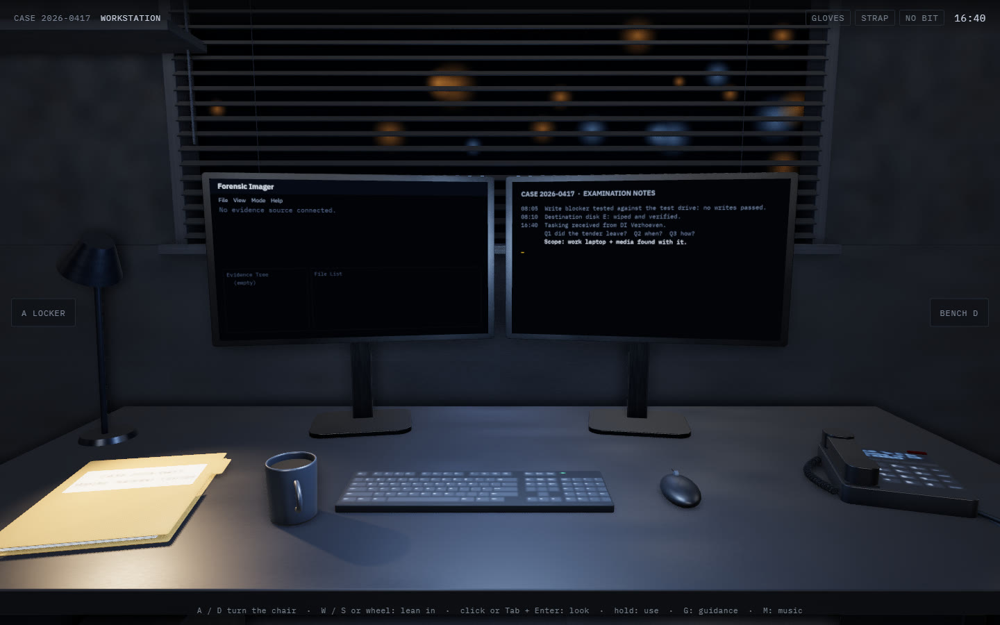
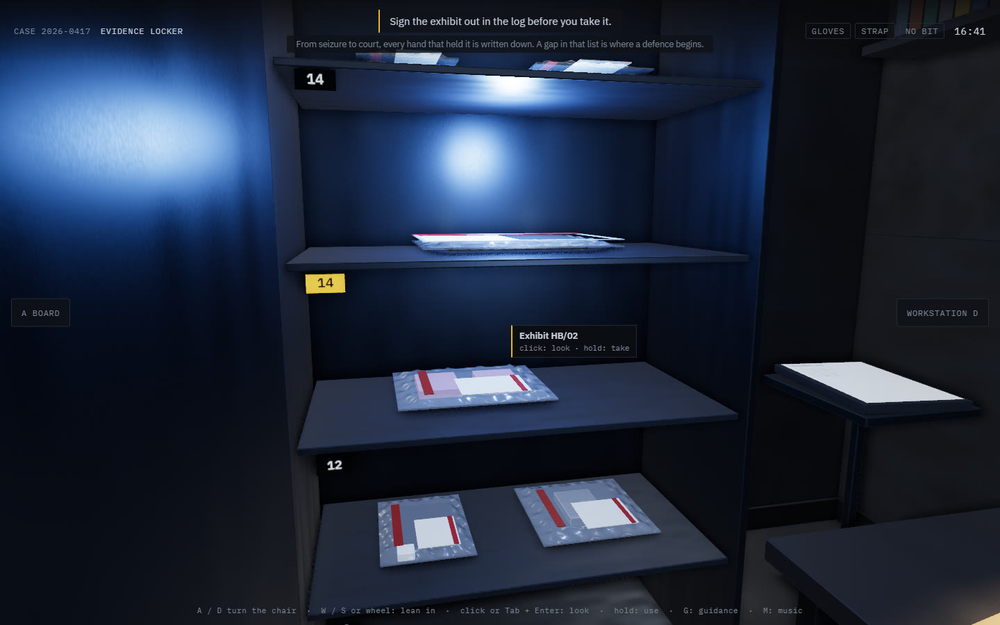
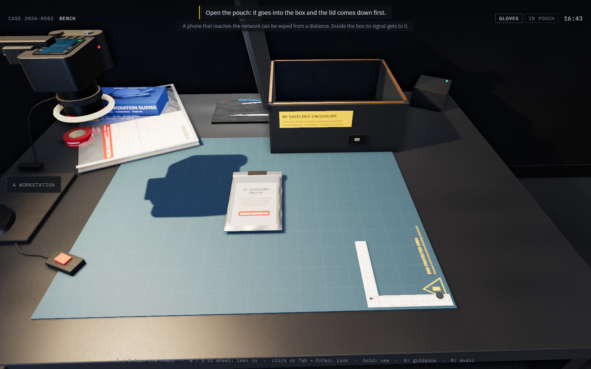
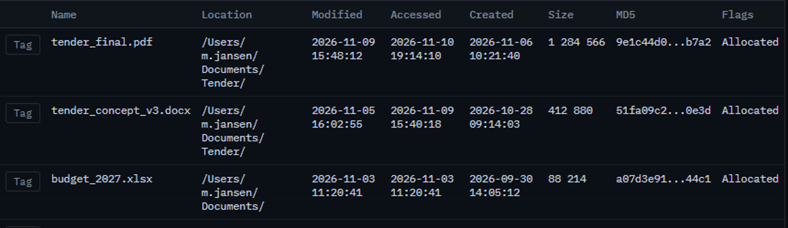
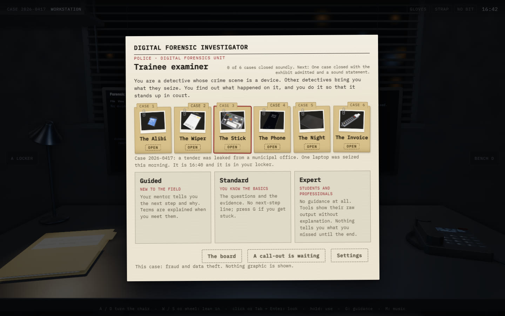

# Digital Forensics

**A first-person game about police digital forensics.** You are the examiner. Detectives bring you a seized device; you find out what happened on it, in a way that stands up in court.

This repository is a showcase. The game is in development and the source code is private.

## The idea

Crime shows make forensics look like magic. The real work is careful and procedural: chain of custody, write blockers, hashes, and a statement that has to survive a defence lawyer. I wanted a game that teaches that work as it is done, step by step, for beginners and for people who already know the basics.

Serious tone, nothing graphic: violent images are never shown, and illegal material only ever appears as a hash match that you stop, record and report.

## One room, every step

You sit in one dark lab and turn between four places: the case board, the evidence locker, the workstation and the bench. Every action is physical and animated: you badge into the locker, sign the exhibit out in the log, photograph the sealed bag, compare the seal number with the form, cut the seal.

## How a case runs

1. **The board.** Take a case file and choose how much help you want: Guided, Standard or Expert.
2. **The call.** The desk phone rings; the detective gives you the questions and the limits of the warrant.
3. **Custody.** Sign the exhibit out and carry the sealed bag to the bench.
4. **The bench.** Gloves, photographs, seal check, and the handling that belongs to the device (a running laptop is not a switched-off phone).
5. **Acquisition.** Image or extract the device, hash it, verify it, write the hash on the custody form.
6. **Examination.** The working copy opens in forensic tools with file tables, timelines and record views. Command-line tools show nothing until you type the command. You tag rows as exhibits.
7. **Statement.** Findings are sentences you complete with values from the rows you tagged. Nothing tells you if you are right.
8. **Court.** A colleague reviews your work, the defence questions the gaps in your own record, and the result is read back rule by rule.

## Six cases

| Case | Exhibit | What it teaches |
|---|---|---|
| The Stick | Laptop | Taking it apart, finding every drive, write blocking and imaging; Windows artefacts and a timeline |
| The Invoice | Encrypted drive from a mail provider | Scope of the warrant, legal privilege; mail headers, a mailbox rule, the audit log |
| The Phone | Handset still switched on | A seal that does not match, a Faraday box first, extraction levels; deleted messages and an unsent draft |
| The Wiper | SSD from a wiped laptop | TRIM, a second read with a different hash, a clock set back; journal order and the hibernation file |
| The Night | Running laptop with ransomware | Order of volatility, cutting power at the right time; memory analysis, triage and a router log |
| The Alibi | SD card with one photograph | Why the lock switch is not a write blocker; EXIF data, the shutter counter and a carved original |

Every case has a better acquisition that unlocks evidence the quicker one cannot see. Mistakes are never game over: they come back as questions in court.

## Scoring and career

You are scored on four things: **Integrity** (your record), **Findings**, **Reasoning** and **Credibility** (honesty in the witness box). Each case ends with a grade stamp: Excluded, Shaky, Sound or Commended. Your best run per case builds a career from Trainee examiner to Expert witness, and higher ranks get a tougher court.

## Tech

TypeScript, Vite and Three.js, with end-to-end tests in Playwright for every case. Tools in the game use real names for free tools and neutral names for commercial ones; no real brands or logos.

## Status

All six cases are playable from start to finish. Next: more realistic 3D models, a review by someone from the field, and saving in the middle of a case.

---

Made by [Stefano van Tongeren](https://github.com/STongeren) · [LinkedIn](https://www.linkedin.com/in/stongeren/)
